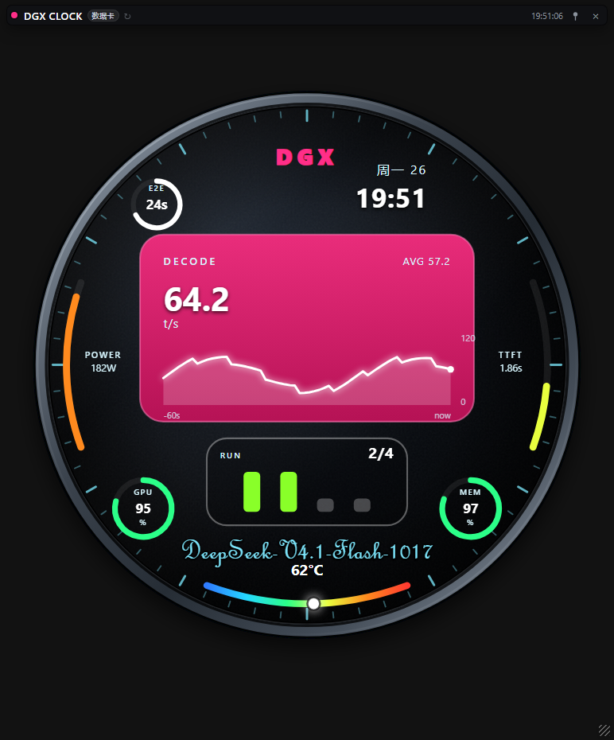
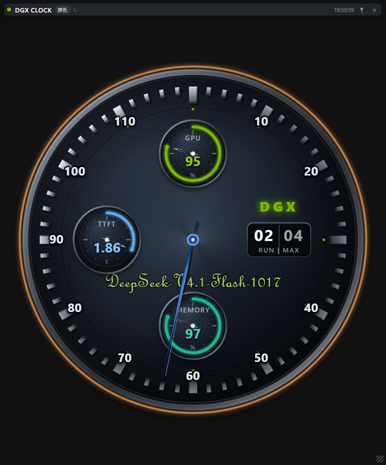
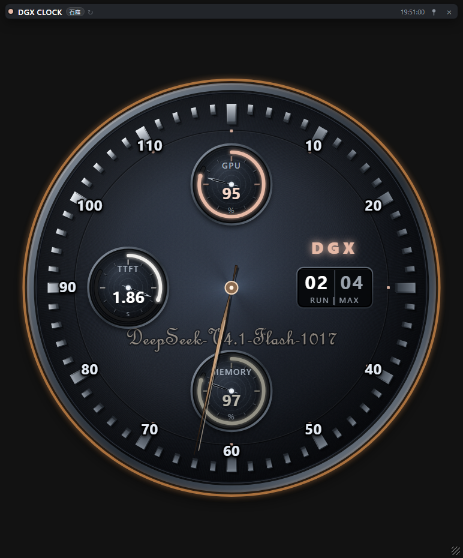
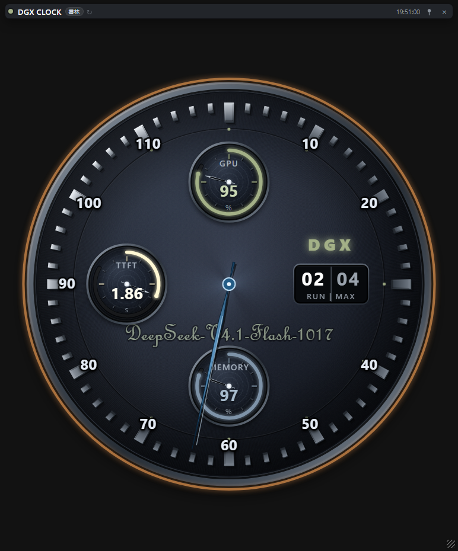
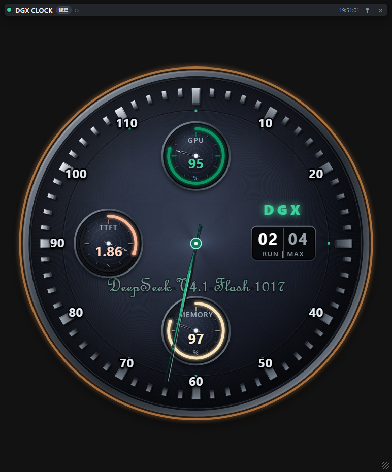

# DGX CLOCK

一个无边框、置顶、**窗体透明**的桌面小表盘：中央指针显示引擎实时 decode t/s，
三眼小表盘显示 GPU / TTFT / MEMORY；也可以切换成数据卡、霓虹表盘等整套外观。
数据通过 SSH 从 GB10（DGX Spark）等主机采集，**不修改被监控主机**。



## 表盘一览

点击标题栏胶囊整套切换；下表是内置 5 档（截图均为 mock 数据）。

| 经典三眼 · 原色 | 经典三眼 · 石庭 | 经典三眼 · 雾林 | 经典三眼 · 翡翠 |
|:---:|:---:|:---:|:---:|
|  |  |  |  |

| 数据卡 · 霓虹 |
|:---:|
|  |

## 特性

- **透明 Electron 窗口**：只保留标题栏和表盘，其余区域透出桌面；无边框、可缩放、位置/尺寸/置顶跨重启保留。
- **整套换表盘**：点击标题胶囊按 `themes.json` 的 `faces[]` 循环，每档 = 布局 + 配色。
  内置 5 档：经典三眼（原色/石庭/雾林/翡翠）+ 数据卡（霓虹）。
- **数据卡**：60s decode 曲线、四格并发柱（1 路绿 → 4 路红）、E2E 环、
  POWER / TTFT 真弧、GPU / MEMORY 环、固定彩虹温度弧 + 沿弧滑动游标。
- **无数据优雅回落**：引擎 idle / 断连时指针 2.2s 线性回零，数值显示 `--`。
- **零前端构建**：原生 ES modules + SVG，无打包器、无框架。
- **配置化**：主机/SSH/量程在 `config.json`，配色/表盘/温度环在 `themes.json`。

## 目录

```
main.py                 入口
dgxclock/               配置、采集、HTTP、Electron 启动
  dashboard.py          复用 dashboard 采集链（注入 webview 空壳）
  server.py             /、/metrics、/themes、/config
ui/                     模块化前端（ui/index.html + app.css + js/）
  js/faces/classic.js   经典三眼布局
  js/faces/card.js      数据卡布局
ui.html                 单文件回退页（只含经典脸）
electron/               透明窗口外壳（main.js / preload.js）
dashboard/              采集链 vendor（gb10_monitor.py / engine_adapters.py）
themes.json             配色库 + faces 表盘清单 + 温度参数
config.example.json     配置模板
PLAN.md                 设计/阶段记录
```

## 快速开始（源码运行）

要求：Windows 10/11、Python 3.10+、Node.js（首次装 Electron 运行时）、
到目标主机的 SSH 免密登录。

```powershell
# 1. 配置
Copy-Item config.example.json config.json
# 编辑 config.json：hosts[].host / ssh.key

# 2. Electron 运行时（约 300 MB，只需一次）
cd electron
npm install
cd ..

# 3. 启动
python main.py
```

启动后点击标题栏的 `DGX CLOCK` 胶囊切换表盘；右上角可置顶/关闭。

## 打包便携版

```powershell
python build_portable.py --zip
# 产物：dist\DGX CLOCK\DGX CLOCK.exe + dist\DGX-CLOCK-portable-<date>.zip
```

便携包自带 Python / Electron 运行时，目标机不需要装 Python/Node。

## 配置

- `config.json`（不入库）：主机、SSH 私钥、采样间隔、表盘量程、默认窗口。
- `themes.json`：`themes` 配色库、`faces` 表盘清单（顺序即切换顺序）、
  `temperature` 温度阈值/颜色/数据卡弧显示范围。
- 新增表盘：`ui/js/faces/<id>.js`（导出 `defs/staticSvg/live/after`）+
  `ui/js/main.js` 的 `LAYOUTS` 注册 + `themes.json` 的 `faces` 一条。

## 隐私

- 本仓库**不包含**任何真实主机地址、用户名、私钥或令牌；`config.json` 被 `.gitignore` 排除。
- 程序不联网上传数据；只从你配置的 SSH 主机读取 GPU/内存/引擎指标。
- 温度、tokens 等只在本机内存中计算与显示。

## 采集链

`dashboard/gb10_monitor.py` 与 `engine_adapters.py` 是采集层的 vendored 副本
（Collector / MetricsState / 引擎适配器），本项目只读复用；
上游 dashboard 的窗口代码不参与运行（运行时注入空壳 `webview`）。

## 许可

MIT，见 [LICENSE](LICENSE)。

本项目与 NVIDIA 无隶属关系；DGX / GB10 是其各自权利人的商标。
